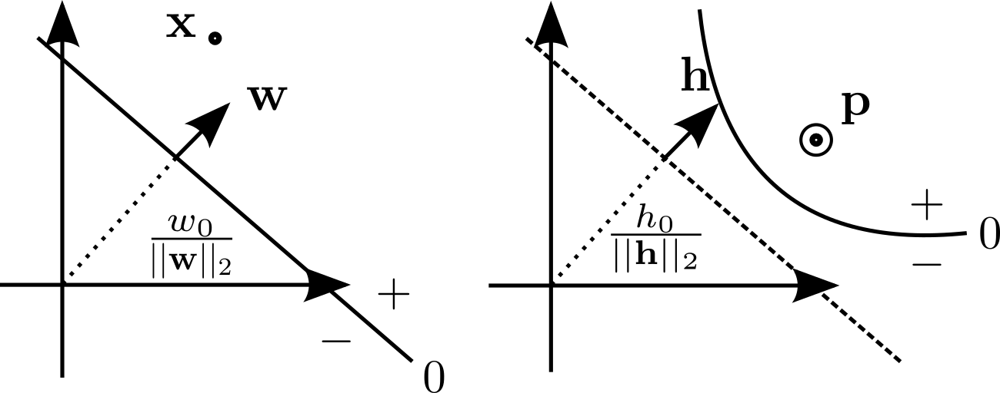
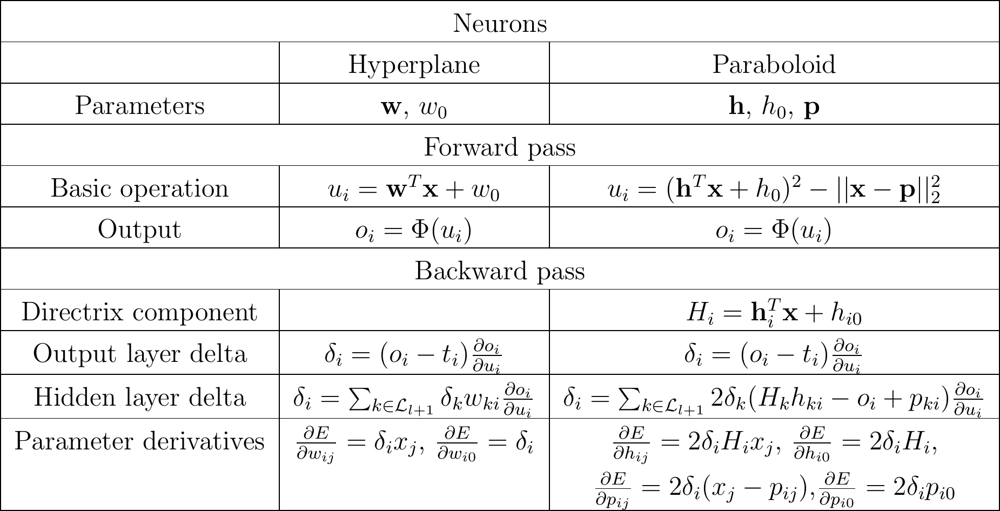

### Overview

This repository is meant as a proof of concept for how paraboloid neurons can be used to achieve similar performance with significantly fewer parameters (35%) by replacing the entire feed-forward component of a transformer with a single paraboloid neuron layer.

|   Model           | Epochs        | Parameters | Training loss | Validation loss | Batches/sec |
| ----------------- | -------------        | -------- | -------- | -------- | -------- |
| ```NanoGPT```, baseline       | 3       | 4.484 Million | 0.4498577415943146 | 0.4255075752735138 | 11.6-11.9 |
| ```NanoGPT```, paraboloid feed forward        | 3       | **2.908** Million | 0.45499327778816223 | 0.4283764958381653 | *13.1-13.4 |

*This speed is achieved by the proprietary library, the free library is **SIGNIFICANTLY SLOWER**.

# Using paraboloid neurons to train NanoGPT models on TinyStories with PyTorch

Paraboloid neuron demonstration of the [GeoND Library](https://geond.tech) for [PyTorch](http://pytorch.org/) on the TinyStories dataset. If you are interested in trying out the library on your own datasets, please refer to the ["How to use"](https://geond.tech/geond-docs/) section of the documentation. This repository uses Version 1.2 of the GeoND Library. You can find download instructions for the free versions of the library here: [https://geond.tech/download/](https://geond.tech/download/). Adapted from [https://github.com/broskicodes/slms](https://github.com/broskicodes/slms).

## Paraboloid neurons

A paraboloid neuron is a second degree neuron that only involves twice as many parameters as a linear neuron. This is achieved by using the definition of a paraboloid as the locus of points that are equidistant from a directrix hyperplane and a focal point. The decision boundary of a linear neuron is **w**<sup>T</sup>**x**=0 (**w** is the weight vector and **x** is the input point), whereas for a paraboloid neuron is (**h**<sup>T</sup>**x**)<sup>2</sup> - ||**x**-**p**||<sub>2</sub><sup>2</sup>=0 (**h** is the directrix and **p** is the focus). These are illustrated below:



The math equations behind them with the corresponding linear neuron equations are summarized below:



## Requirements
- Linux only.
- Python 3.9+, use of a virtual environment recommended.
- Install the rest of the requirements by running:
```
pip install -r requirements.txt
```
- (Optional) Download the pre-trained models by running:
```
wget -i models.txt -P models
```

## IMPORTANT
Including any layer with paraboloid neurons requires a specialized optimizer. As of version 1.1, the GeoND Library includes an adaptation of Adam and AdamW and as of version 1.2 some previous issues have been fixed. In order to properly train a network that includes paraboloid neurons with Adam(W), we need to define:
```
optimizer = gpt.GeoNDAdamW(model.parameters(), lr=learning_rate, betas=(0.9, 0.999, 0.9999))
```

## Models
- ### NanoGPT
Our baseline GPT model.


- ### NanoGPT-paraboloidff
A GPT model with a layer of paraboloid neurons replacing the entire FeedForward component of the transformer.

In terms of code, first we import the Library:
```
try:
    import geondpt as gpt
except ImportError:
    import geondptfree as gpt
```

Then we change the original FeedForward component:
```
    self.net = nn.Sequential(
      nn.Linear(n_embed, n_hidden),
      nn.ReLU(),
      nn.Linear(n_hidden, n_embed),
      nn.Dropout(dropout)
    )
```
By replacing the hidden layers with a ```ParaboloidBatched``` layer:
```
    self.pb = gpt.ParaboloidBatched(n_hidden, n_embed, input_factor = 1., mom_factor = 0.7/0.9, wd_factor = 0.01, h_factor = 0.0001, p_factor = -0.01, output_factor = 0.001, grad_factor = 0.001, h_lr_factor = 1., p_lr_factor = 1.)
```

- ### NanoGPT-reducedff
A GPT model that uses the original FeedForward architecture, but with the same number of parameters as the paraboloid neuron above.

In terms of code, we change :
```
    self.ffwd = FeedForward(n_embed, n_embed*4, dropout)
```
Into:
```
    self.ffwd = FeedForward(n_embed, n_embed, dropout)
```


## Evaluation of pretrained models

|   Model           | Epochs        | Parameters | Training loss | Validation loss | Batches/sec |
| ----------------- | -------------        | -------- | -------- | -------- | -------- |
| ```NanoGPT```, baseline       | 3       | 4.484 Million | 0.4498577415943146 | 0.4255075752735138 | 11.6-11.9 |
| ```NanoGPT```, reduced feed forward       | 3       | 2.908 Million | 0.47032883763313293 | 0.4420813024044037 | 13.9 |
| ```NanoGPT```, paraboloid feed forward        | 3       | 2.908 Million | **0.45499327778816223** | **0.4283764958381653** | *13.1-13.4 |

*This speed is achieved by the proprietary library, the free library is **SIGNIFICANTLY SLOWER**.

## Training, testing and evaluation

First change directory to either ```baseline```, ```paraboloidff``` or ```reducedff``` depending on which model you want to work on then run:

- ```python eval.py``` to evaluate the downloaded pretrained model.
- ```python test.py``` to generate a short story using the model.
- ```python train.py``` to train the model from scratch.

## References
- Original repository: [https://github.com/broskicodes/slms](https://github.com/broskicodes/slms)
- GeoND Library documentation: [https://geond.tech/geond-docs/](https://geond.tech/geond-docs/)
- Paraboloid Neurons: [https://geond.tech/wp-content/uploads/2024/06/NPDBINNCP.pdf](https://geond.tech/wp-content/uploads/2024/06/NPDBINNCP.pdf)
